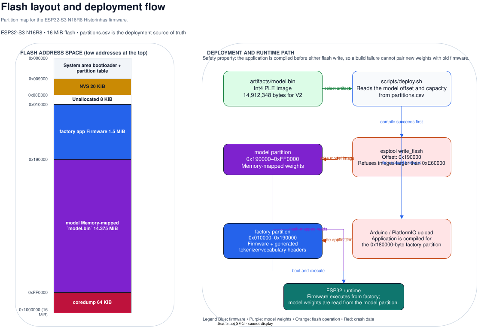

# Flash layout

Historinhas uses the full 16 MiB flash available on the ESP32-S3 N16R8.
`firmware/historinhas/partitions.csv` is the single source of truth for both
deployment paths.



The editable source is [flash-layout.drawio](diagrams/flash-layout.drawio).

| Partition | Offset | Size | Purpose |
| --- | ---: | ---: | --- |
| `factory` | `0x010000` | `0x180000` | Firmware application |
| `model` | `0x190000` | `0xE60000` | Memory-mapped model binary |

The deployment script obtains the model offset and capacity from the partition
CSV instead of duplicating them. It refuses an artifact larger than the `model`
partition before flashing.

```bash
python firmware/historinhas/tools/partition_layout.py --name model
stat -c '%n: %s bytes' artifacts/model.bin
```
