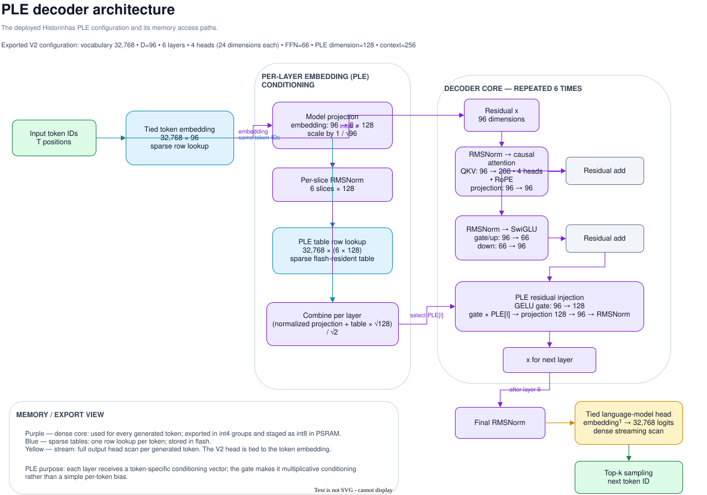

# Model artifacts



The editable source is [ple-architecture.drawio](diagrams/ple-architecture.drawio).

`research.export` converts a PLE checkpoint into a self-contained local bundle:

```text
artifacts/
├── model.bin
├── tokenizer.json
├── metadata.json
├── golden.npz
└── golden.txt
```

`model.bin` is the memory-mappable inference format. `tokenizer.json` is copied
from the exact tokenizer verified against the checkpoint. `metadata.json` records
the model configuration, source checkpoint provenance, and SHA-256/byte counts
for distributable files. `golden.txt` is an optional exact-logit fixture used by
the host verifier.

Artifacts are intentionally ignored by Git. A published release must pin the
SHA-256 and byte size of `model.bin` and `tokenizer.json` before
`scripts/fetch_model.sh` is enabled.
