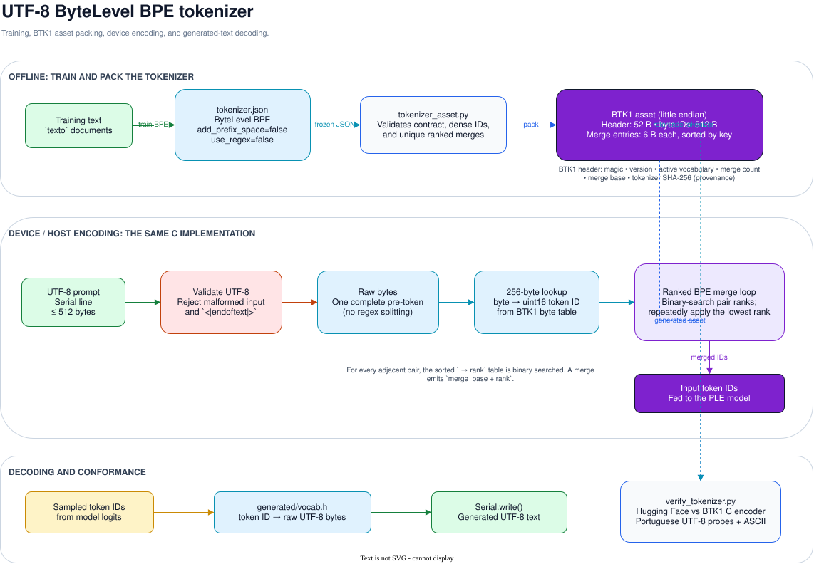

# UTF-8 tokenizer contract

Historinhas uses `ByteLevel(add_prefix_space=False, use_regex=False)` on a BPE
model. The complete UTF-8 prompt is one pre-token, followed by ranked BPE
merges. The ESP32 implementation validates UTF-8 before encoding and rejects
malformed byte sequences.

The editable source is [bpe-tokenizer.drawio](diagrams/bpe-tokenizer.drawio).

`firmware/historinhas/tools/tokenizer_asset.py` validates the tokenizer JSON and
packs its byte-symbol table and merge ranks into the BTK1 asset.
`firmware/historinhas/tools/verify_tokenizer.py` compares the generated device
asset with Hugging Face over Portuguese UTF-8 probes and printable ASCII.

`<|endoftext|>` is reserved by firmware and cannot occur literally in an
interactive prompt. It remains the document separator during training and the
end marker during generation.
