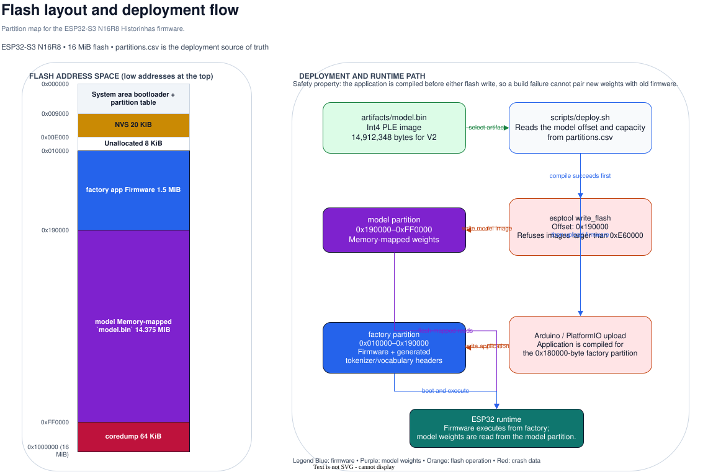
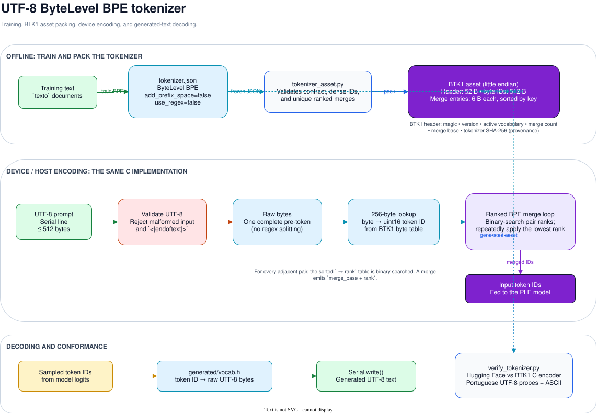
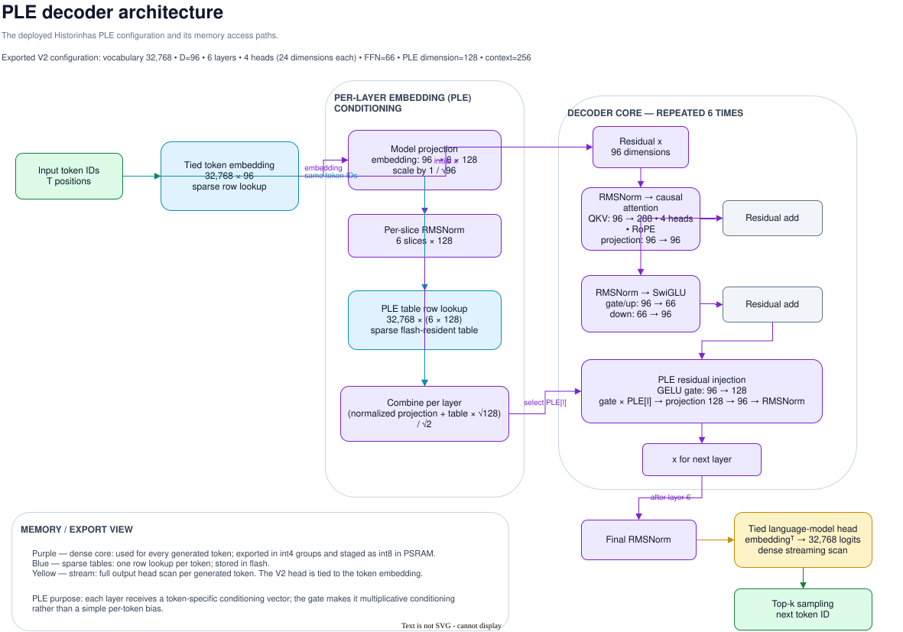

# Architecture diagrams

These diagrams describe the deployed Historinhas system. Each diagram is stored
in two forms:

- `.drawio`: editable source for draw.io / diagrams.net.
- `.svg`: rendered version embedded by the documentation and viewable on GitHub.

| Diagram | Purpose |
| --- | --- |
| [Flash layout](flash-layout.svg) | ESP32-S3 N16R8 partitions and the model/firmware deployment flow. |
| [UTF-8 ByteLevel BPE tokenizer](bpe-tokenizer.svg) | Tokenizer training, BTK1 packing, device encoding, decoding, and conformance testing. |
| [PLE decoder architecture](ple-architecture.svg) | The V2 PLE model configuration, per-layer conditioning path, decoder block, and memory access tiers. |

## Editing and exporting

Open a `.drawio` source file in the draw.io desktop application or at
[diagrams.net](https://app.diagrams.net/). After editing a source file, refresh
its SVG from the repository root:

```bash
drawio --export --format svg --theme light --embed-svg-fonts false \
  --output docs/diagrams/flash-layout.svg docs/diagrams/flash-layout.drawio
```

Repeat the command for the other two sources. The labels and values must remain
consistent with `firmware/historinhas/partitions.csv`,
`runtime/bpe_tokenizer.h`, and `artifacts/metadata.json` when the V2 artifact is
being documented.

## Previews

### Flash layout



### UTF-8 ByteLevel BPE tokenizer



### PLE decoder architecture


